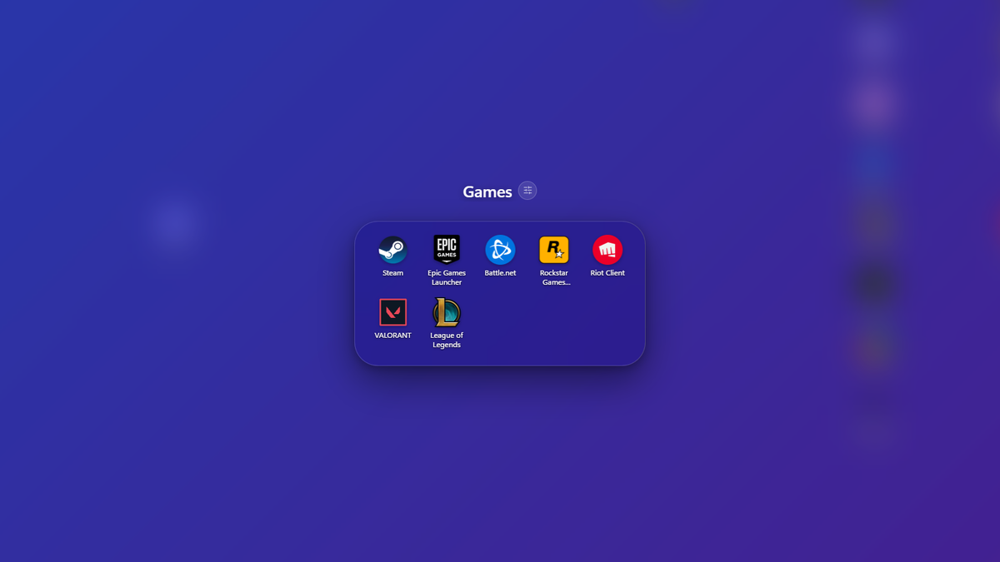
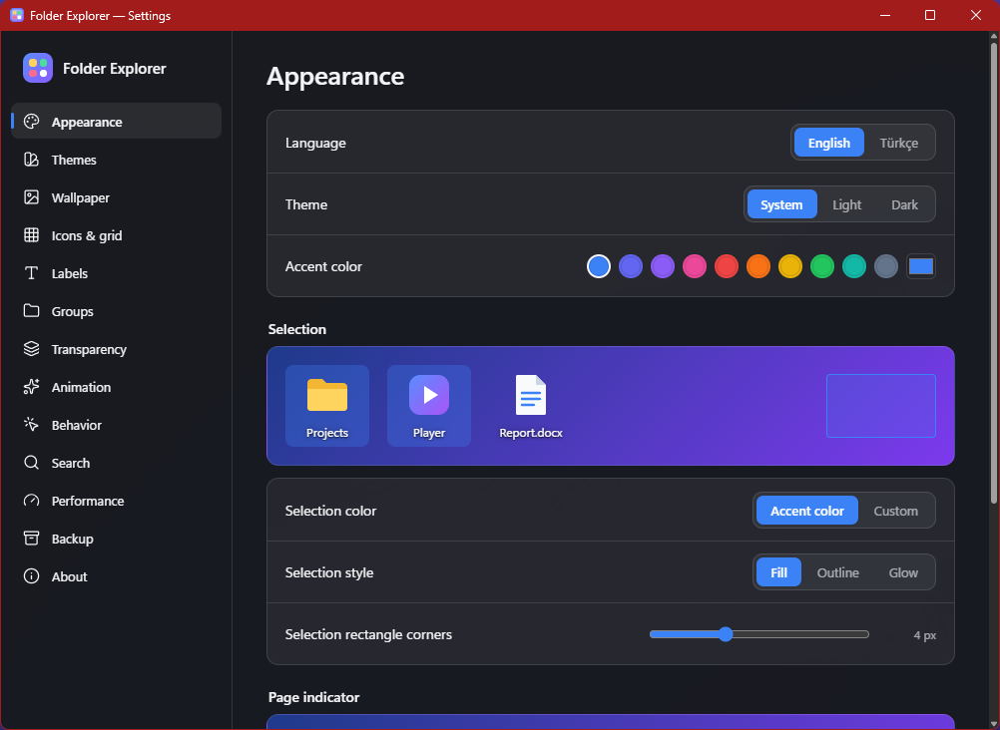

<div align="center">


# Folder Explorer

**Phone-style folders for your Windows 11 desktop.**<br>
Drop one icon on another to make a group, the way you would on a phone. Your files never move.

[**Download**](https://github.com/Cafunw/folder-explorer/releases/latest) · [Features](#features) · [Uninstall](#uninstall-and-getting-your-desktop-back) · [Build from source](#build-from-source) · [Türkçe](README.tr.md)

[](https://github.com/Cafunw/folder-explorer/releases/latest)
[](https://github.com/Cafunw/folder-explorer/releases)

[](https://github.com/Cafunw/folder-explorer/actions/workflows/ci.yml)
[](LICENSE)


</div>

Folder Explorer draws its own desktop on top of your wallpaper and hides Explorer's icons while it runs. Groups, fences and headings live only in Folder Explorer's layout file, so nothing is moved on disk and Windows' own desktop comes back as soon as you quit.

## Download

1. Get **`Folder.Explorer_<version>_x64-setup.exe`** from the [latest release](https://github.com/Cafunw/folder-explorer/releases/latest) and run it. It installs for your user only, no administrator rights needed. The installer speaks English and Turkish, and the app starts in the language you pick there (change it any time in *Settings ▸ Appearance*).
2. The installer isn't code-signed yet, so Windows may show *"Windows protected your PC"*. Click **More info → Run anyway**. Every release lists the installer's SHA-256, and you can always [build it yourself](#build-from-source).

Requires Windows 11 (x64). WebView2 is already part of Windows 11. New versions are offered in the app itself; nothing is installed until you click *Install*.

## Features

- **Groups by drag and drop.** Drop an icon on another to make a group, drop more on it to add, drag out to take one back. Groups can hold groups, and every one has its own name, color, background and preview grid.
- **Your files stay where they are.** Groups are virtual. Renaming or deleting an icon acts on the real file (to the Recycle Bin), and Ctrl+Z undoes layout changes and file operations alike.
- **Fences, headings and dividers.** Always-open boxes on the desktop in the style of Fences, plus section headings and dividers to structure a page.
- **Groups that fill themselves.** A *smart group* collects desktop icons by rule (extension, name, type, age). A *live folder* shows a real folder such as Downloads and follows its changes. *Most used* lists what you open most. A *temporary group* flags items older than N days and archives them for you.
- **Windows' own menus.** Right-click opens Explorer's real context menus (including *Show more options* and *New ▸*), and Windows' *New ▸* menu gets a *New group* entry (you can turn it off).
- **Search and command palette.** Start typing on the desktop to find apps, desktop items, files from the Windows index, Settings pages, a calculator and web search. Ctrl+Shift+P opens the command palette, Space opens Quick Look.
- **Make it yours.** Theme presets, light and dark modes, icon plates and icon packs, a wallpaper per page or for day and night, an accent color taken from the wallpaper, and open and page animations.
- **Locked groups.** Hide a group's content behind Windows Hello or a PIN.
- **Light on your PC.** No CPU use when idle, game mode for full-screen apps, a battery mode, pages on every monitor, and icon sizes that follow Windows' own setting.

## Screenshots

<table>
  <tr>
    <td width="50%"></td>
    <td width="50%"></td>
  </tr>
  <tr>
    <td align="center">An open group; the desktop behind it is blurred</td>
    <td align="center">Settings, with English and Turkish</td>
  </tr>
</table>

The screenshots use Folder Explorer's own gradient wallpaper.

## How it works

Folder Explorer is a [Tauri 2](https://tauri.app) app: a Rust backend that talks to Windows and a React interface in WebView2. The backend places a transparent window just above the wallpaper, hides Explorer's desktop icon list and shows the same items in its own grid. It reads your desktop folders, icons and wallpaper but changes nothing in Windows, with two exceptions you control: the *New ▸ New group* entry and the *Start with Windows* shortcut.

If Explorer or the interface crashes, Folder Explorer brings Windows' icons back and restarts itself. Your layout is saved to `%APPDATA%\Folder Explorer\state.json` as you go, with the last 10 versions kept as backups.

The details, including every command and file format, are in [docs/ARCHITECTURE.md](docs/ARCHITECTURE.md).

## Mouse and keyboard

| Do this | How |
|---|---|
| Make a group | Drag an icon onto the middle of another |
| Open a group | Click it; Esc goes back up |
| Rename | F2, or click a group's title |
| Delete | Delete (to the Recycle Bin; a deleted group leaves its items on the desktop) |
| Undo / redo | Ctrl+Z / Ctrl+Y |
| Search | Start typing on the desktop |
| Command palette | Ctrl+Shift+P, or `>` in search |
| Quick Look | Space on a selected icon; ← → for the next one |
| Edit icons (jiggle mode) | Long-press an icon, or *Edit icons* in the tray menu |
| Icon size | Ctrl + mouse wheel |
| Open files with an app | Drop them on the app's icon (Shift+drop makes a group instead) |
| New group | Ctrl+Shift+N, or *New ▸ New group* on the desktop |

## Privacy

Folder Explorer has no telemetry. Its one network request of its own is the update check: once a day it reads which version the latest GitHub release is, sending nothing about you (turn it off in *Settings ▸ Behavior ▸ Check for updates*). Otherwise the web is only reached when you ask: a web search from the search bar opens Google in your browser, and a URL shortcut you create opens its address.

## Uninstall and getting your desktop back

- **Quit** from the tray icon: Windows' icons come back right away.
- **Uninstall** from *Settings ▸ Apps ▸ Installed apps*. Tick *Delete the application data* to remove `%APPDATA%\Folder Explorer` (layout, settings, backups) as well.
- **Icons missing after a crash?** Right-click the tray icon and choose *Show Windows icons*, or run `folder-explorer.exe --show-icons` from the install folder. If you hid desktop icons in Windows itself (*View ▸ Show desktop icons*), Folder Explorer leaves that setting alone.

## Known limitations

- Windows 11 x64 only. Other desktop organizers that also replace the icon layer will conflict.
- Monitors with different scaling are drawn with the main window's scale factor, so sizes on a secondary monitor can be slightly off.
- The installer is unsigned for now (see [Download](#download)).
- Windows' own *View* and *Sort by* commands on the desktop menu act on Explorer's hidden icons; use Folder Explorer's settings, Ctrl+wheel and the command palette instead.

## Build from source

You need Node.js, Rust (stable, MSVC toolchain) and WebView2 (part of Windows 11).

```bash
npm install
```

```bash
npm run tauri dev
```

```bash
npm run tauri build
```

The last command writes the installer to `src-tauri/target/release/bundle/nsis/`. Checks: `npm test`, `npm run typecheck`, `npm run lint`, and `cargo test --lib` and `cargo clippy` in `src-tauri/`; CI runs all of them on every push.

## Contributing

Bug reports, ideas, translations and pull requests are welcome; [CONTRIBUTING.md](CONTRIBUTING.md) explains how to build, test and where things live. Issues marked [good first issue](https://github.com/Cafunw/folder-explorer/labels/good%20first%20issue) are a nice place to start, and [Discussions](https://github.com/Cafunw/folder-explorer/discussions) is open for questions. Please report security issues privately, as described in [SECURITY.md](SECURITY.md).

## License

[MIT](LICENSE)
